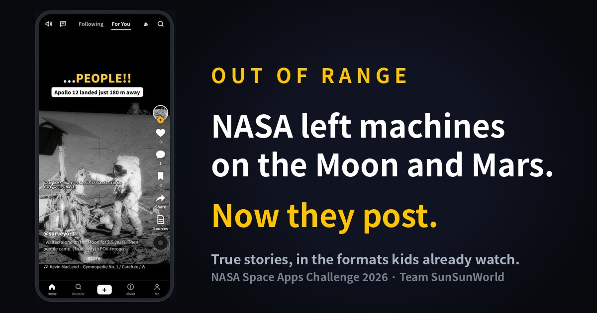

# OUT OF RANGE



**Live:** https://taiyoishikawa2003.github.io/out-of-range/ (no login; phones, tablets and PCs; English / 日本語)

A social feed for the machines NASA left on the Moon, on Mars and in deep space. They no longer answer Earth, so here they post. The jokes are only in the format. The stories are true, and every post links to its NASA sources.

NASA Space Apps Challenge 2026, challenge *Abandoned but not Forgotten: Storytelling about NASA's Discarded Equipment on the Moon and Mars*. Team SunSunWorld (Kushimoto, Japan).

## Why a short-video feed?

The challenge asks for a story that introduces school-age kids to this hardware and the science it made possible. Kids already spend their time in short-video feeds, including kids who are not interested in space. So we put the machines there, in formats those kids already know: a scary story, a spot-the-difference, a vlog, a room tour, a group chat, a ranking, a game. Under each post, the pinned comment tells the real story: what the machine is, why it was sent, what it found and where it is now.

There are two kinds of accounts. "Machines" are written in the machine's own voice, and each profile shows the month contact was lost ("Out of range since June 2018"). "Channels" post about the machines. Our team writes both, and every profile says so.

## What is in the feed

| Post | Machine (place) | Format |
|---|---|---|
| "This was recorded on Mars." | InSight (Mars) | Scary-story video built on the real sound of a meteoroid impact |
| What did people leave on the Moon the most of? | Apollo landing sites (Moon) | Photo post with a tappable quiz |
| Something vanished from a hole on Mars | Phoenix (Mars) | Spot-the-difference video made from two real photos taken four days apart |
| I waited on the Moon for 2.5 years | Surveyor 3 (Moon) | POV story video |
| OPPORTUNITY | Opportunity (Mars) | Landscape movie trailer in a "PR" slot (our own trailer, not a real ad) |
| Try driving me like an RC car | Opportunity (Mars) | Playable game: feel the 20-minute signal delay, then drive the way rover drivers really did |
| Pioneer 10's nav app | Pioneer 10 (deep space) | Nav app video: "arrive in about 2 million years" |
| Case file | Viking 1 (Mars) | Photo post: detective file with a tappable quiz |
| Working on Mars, day 3 | Sojourner (Mars) | Daily vlog video: planned for 7 days, worked for 83 |
| Expectation vs reality | Spirit (Mars) | Photo post: a broken wheel digs up evidence of ancient hot springs |
| NASA's "favorite" zodiac signs | Kepler (deep space) | Ranking video made from real Kepler data |
| Room tour: 50 years alone on Mars | Viking 2 (Mars) | Photo post: rent $0, great view, floor tilted 8.5 degrees |
| While they were out partying | Dawn (asteroid belt) | Parody of a motivation video: four days to reach 60 mph, for 5.9 years |
| Which space machine are you? | 8 machines | Interactive just-for-fun quiz |
| I went to Jupiter and Saturn | Pioneer 11 (deep space) | Photo dump: real photos from the trip, no return ticket |
| "Want to try landing?" | NEAR Shoemaker (asteroid Eros) | Group chat video |
| Fashion check | Apollo 17 rover, Ingenuity, InSight, Apollo 11 lander | Photo post: four looks, four real reasons |
| Things machines left on Mars always do | Mars Pathfinder, Spirit, Opportunity, Viking 1 and 2, Phoenix, Ingenuity | "So relatable" list with real photos: bouncing landings, a photo of their own foot, nicknames, names chosen by kids |
| Worked longer than planned: TOP 5 | Opportunity, Spirit, Viking 1, Pioneer 10, Ingenuity | Ranking countdown video |
| We texted 1,000 times. No reply. | Opportunity (Mars) | Chat video. The last post: after it, the feed says "Past this point: out of range" and opens the map |

Beyond the feed:

- **Where are they now?** (`#/map`): maps of the Moon and Mars with 23 machines. Tap a pin to see what the machine is, why it was sent, what it found and where it rests now. Positions come from NASA's NSSDCA catalogue.
- **Lunar Lost & Found** ([`/lost/`](https://taiyoishikawa2003.github.io/out-of-range/lost/)): a second, separate piece. A counter for things left on the Moon; each claim slip leads to the machine next to it and a small hands-on science scene (laser ranging, moonquakes, Moon gravity).
- **30-second demo**: [`/demo/`](https://taiyoishikawa2003.github.io/out-of-range/demo/)

## Features

- Vertical swipe feed with autoplaying video, sound, seek bar, tap to pause, double-tap to like
- Swipeable photo posts with tappable quizzes and per-slide music
- Interactive posts (a quiz) and an interactive map of the Moon and Mars
- A **Sources** button on every post, and one page that lists every NASA resource used (About)
- Pinned comments that tell the real story in plain words (what it is, why it was sent, what it found, where it is now) and say which parts we made up
- **Create**: kids make their own true post in the browser. A source is required. Posts stay on the device
- Discover (search, Moon / Mars / Deep space filters) and a profile page for every account: machines show the month contact was lost, and every profile says our team writes it
- Read-aloud for photo posts, English / 日本語, keyboard controls, reduced-motion support
- Fact-check stamps: opening a post's Sources earns that post's stamp, so the habit of checking where a fact comes from becomes a collection game
- Comment threads where the other machines reply in character (the lines are ours, the facts in them are sourced)
- A printable one-page classroom worksheet in English and Japanese (`class/`)
- Accessibility checked with axe-core (WCAG 2 A and AA rules): no violations on the feed, quiz, game, map, About, Create, Lost & Found and worksheet pages (automated checks do not cover everything)
- ふりがな (furigana): a reading aid for younger Japanese readers. One tap adds small kana above words that use kanji taught after grade 2. The word list is built from the app's own text and checked by a script (`tools/furigana/`)
- Privacy: no accounts, no ads, no tracking. Likes, follows, comments and created posts stay in the browser
- Works offline after the first visit (service worker)

## How we keep it accurate

- Every fact is checked against NASA pages (NASA Science mission pages, NSSDCA, the NASA Image and Video Library and the JPL Photojournal) before it is posted. Each post lists its sources.
- Numbers we calculated ourselves (walking time to Aldebaran, "times longer than planned") are marked as our calculation, with the assumptions written out.
- Real photos are labelled "Real photo". NASA artist's concepts are labelled "Artist's concept". We do not use AI-generated images, video or voices.
- Lines we made up (the chats, the POV thoughts, the comments) are labelled as ours in the pinned comment of each post.

## Run locally

Any static server works:

```
python3 -m http.server
```

Then open http://localhost:8000/. There is no build step for the site itself (plain HTML, CSS and JavaScript modules).

## How posts are made

- `data/posts.json` is the feed. `data/accounts.json` holds the accounts (machines and channels). `data/library.json` is the photo library for Create.
- Wording lives in one file: `tools/texts.py` has the captions, pinned comments, comments from other machines, profile text and the feed order. `python3 tools/apply_texts.py` writes it into the data files. Run it after rebuilding any post.
- Photo posts are written as small HTML slides and rendered to images:
  - `tools/slides/p_*.py`: one file per post (slides, caption, pinned comment, sources) in Japanese and English
  - `tools/slides/slides.css`: the slide design system
  - `python3 tools/slides/build.py [post ...]` renders the slides with headless Chrome and updates `data/posts.json`
  - NASA photos are read from `$OOR_ASSETS/<nasa_id>.jpg` (download them from images.nasa.gov; the ids are in each post file)
- Motion videos are web pages with a timeline, recorded frame by frame:
  - `tools/motion/v_*.html`: one page per video (scenes, text, sound cues) in Japanese and English
  - `tools/motion/motion.js`: the small timeline runtime; `tools/motion/make_sfx.py` synthesizes the interface sounds
  - `node tools/motion/build.mjs <page> <output>` records the frames with headless Chrome and mixes the sound with ffmpeg; `python3 tools/motion/publish.py` puts the videos into `data/posts.json`
- `data/machines.json` holds the map entries (position, what / why / found / now, sources). `js/map.js` draws the map.
- Interactive posts live in `js/apps/` (`shindan.js`, the quiz; `lag.js`, the rover-driving game).
- The furigana word list `data/furi.json` is built by `node tools/furigana/build.mjs` (needs `npm install kuromoji`). It splits every Japanese string the app shows into words, keeps the ones with kanji taught after grade 2, and checks that looking the words up gives the same result as the word-by-word analysis. Readings fixed by hand are in `tools/furigana/overrides.json`. Run it again after changing Japanese text.
- `tools/build_*.py` build the earlier videos and photo posts. `tools/version_media.py` adds a content hash to every media path.
- `tools/nasa_collect.py` collects candidate media for every machine on the official challenge resource list (`data/nasa_catalog.json`).

## Videos about the project

- 30-second demo (English, small Japanese): https://taiyoishikawa2003.github.io/out-of-range/demo/
- Walkthrough in under 3 minutes (Japanese with English subtitles): https://taiyoishikawa2003.github.io/out-of-range/walkthrough/

Both are recorded from the real site by `tools/motion/demo.html` and `tools/motion/pitch.html`.

## Images for slides and posts

`docs/press/` has ready-made images: `cover_1200x630.jpg` (link preview) and `screens_en.jpg` / `screens_ja.jpg` (four screens, 1920×1080).

## Use of AI

We used an AI assistant (Claude by Anthropic) for code, drafts and source look-ups, under the team's direction. The team chose the concept, the audience and the rules (formats kids already know, jokes in the format only, every fact real). Some post ideas came from the team and some were proposed by the AI assistant; the team reviews the posts and decides what stays. We do not use AI-generated images, video or voices. Details are on the About page of the site.

## Credits

- NASA images, video and sound: see the Sources of each post and the About page. NASA does not endorse this project.
- Music: Kevin MacLeod (incompetech.com), CC BY 4.0; Holst, "Mars, the Bringer of War", U.S. Air Force Band (public domain, via Wikimedia Commons). Track list on the About page.
- [idb-keyval](https://github.com/jakearchibald/idb-keyval) (Apache-2.0) and [html-to-image](https://github.com/bubkoo/html-to-image) (MIT) in `vendor/`.

## License

Apache License 2.0
